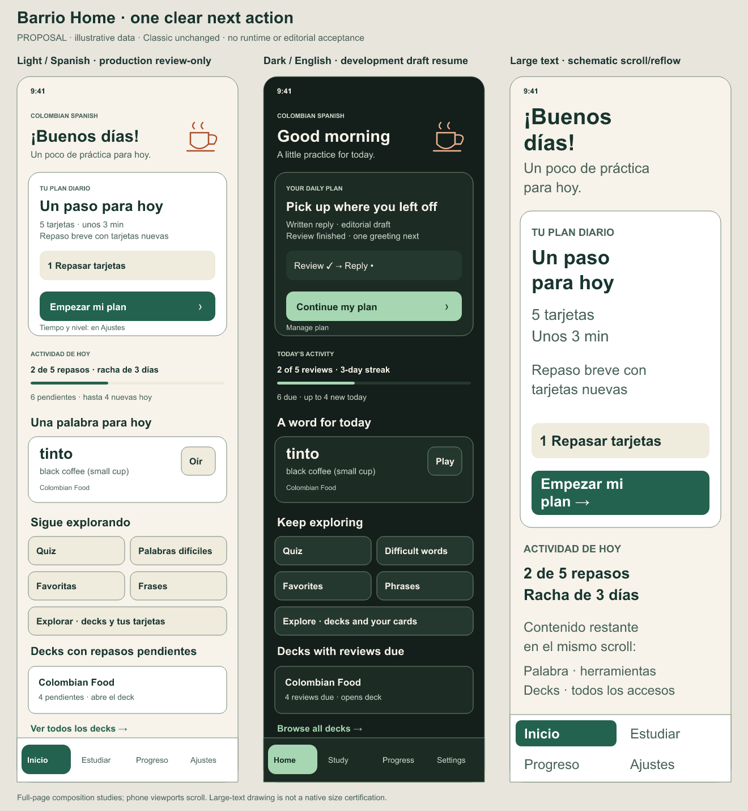
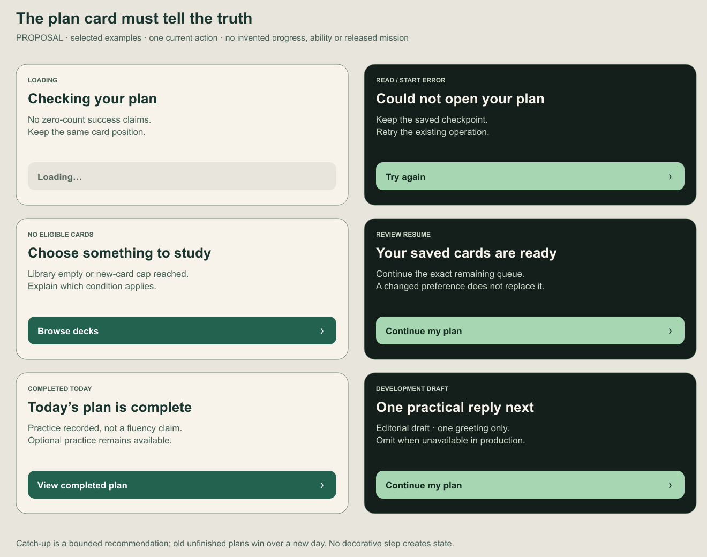

# Barrio Home proposal — B08.3-A

**Review stage: proposed composition, not runtime implementation or an approved architectural spec.** Classic remains the default, stays in the theme picker and retains its current Home. This proposal applies only to Barrio, in Light/Dark/System. Foundation approval does not approve this subsequent Home change.





## Intended outcome and recommendation

The owner requested a more capable, enjoyable and efficient app, selected Barrio and required the current theme to remain available while evaluating it. The approved foundation plan explicitly deferred Home composition. This package makes that next choice concrete: one clearly named next action, quieter workload context, a small daily discovery moment and direct access to existing tools. Improved engagement or learning is a hypothesis for the learner pilot, not a result of the redesign.

Recommend **plan first**, using the existing recommendation and durable-plan behavior. Put the plan action above aggregate library counts; show a small plain-language phase summary only when its actual state supports it. Below it: today's activity, word of the day, practice/discovery entries and due decks. Keep the four existing tabs. Use the shipped Barrio roles and a small original cup illustration that disappears at large text. No animation is required.

Two alternatives were considered. **Dashboard first** retains the current count/goal/streak emphasis and costs less to rearrange, but keeps the learner's next action below competing totals. **Mission first** gives the richest narrative entry, but production currently has no accepted daily response; a prominent coffee-order promise would misrepresent the one-greeting development activity. Plan first can honestly serve review-only production now and an available authored phase later.

## Reading the boards

All counts, time, deck, streak and word examples are illustrative. The left composition shows a possible new review-only production recommendation; the middle shows a development-only applied resume after review. These are different states, not automatic light/dark behavior differences. Both appearances must support every state. The right drawing is a schematic large-text layout with stacked content and two-row tabs; its chosen font sizes do not certify iOS Dynamic Type or physical tap comfort. Full-page compositions are taller than a phone viewport and scroll. Lower-content annotations in the large-text drawing are design notes, not proposed app text.

The state board contains English design notes beneath proposed headings/actions. Those explanatory notes are not final product copy. Exact bilingual strings, their pluralization and all states must be specified and reviewed in the architectural spec. The initial light example's new-card line is conditional: omit it when no new cards are in that recommendation. Time remains an estimate, not a guaranteed finish time.

## State and behavior contract for the later spec

| Condition                                | Proposed presentation and action                                                                                                             | Required source / invariant                                                                                                                                                                                            |
| ---------------------------------------- | -------------------------------------------------------------------------------------------------------------------------------------------- | ---------------------------------------------------------------------------------------------------------------------------------------------------------------------------------------------------------------------- |
| Initial load                             | Stable plan-card skeleton/text; disabled loading action. Hide unknown counts instead of claiming zero work.                                  | Existing provider readiness and focused async read. No storage write on render.                                                                                                                                        |
| Read failure                             | Explain that today's plan could not be read; Retry reloads it. Other browsing remains reachable.                                             | Existing read retry. Do not turn unread data into an empty or completed plan.                                                                                                                                          |
| Starting / save failure                  | Disabled pending action; on failure retain the suggestion/checkpoint and offer retry. Keep failure distinct from a read failure.             | Existing `starting` guard and storage coordinator; no optimistic success or duplicate command.                                                                                                                         |
| Unfinished review, including a prior day | Continue the saved plan; show remaining cards from its exact queue. Manage plan stays reachable.                                             | Stored `DailyPlan.review.session.queue`, not a new recommendation or today's original count. Preference/day changes do not replace it.                                                                                 |
| Unfinished applied phase                 | Continue the linked reply, with honest availability/assistance labels. A phase with no review must not show a fictitious completed review.   | Stored applied identity and existing player availability/recovery. `availableDailyResponse` remains gated; a persisted unavailable draft follows existing safe recovery rather than being silently hidden or replaced. |
| No unfinished plan; eligible review      | Start the bounded recommendation. Show selected card count, estimated duration and conditional new-card/catch-up explanation.                | `recommendDailyReview`, fresh budget/start checks, saved purpose/region/time, current new allowance and measured estimates. Due/new totals below are separate library context.                                         |
| Development-only applied option          | Include the actual greeting phase only when available. Label it editorial draft; never describe it as the full café mission.                 | `SHOW_REVIEW_TOOLS` and `availableDailyResponse`; no content promotion, recording or release-gate changes. Production review-only fallback remains.                                                                    |
| Completed today                          | Show completed-plan status and View completed plan. Optional tools/decks stay available.                                                     | Stored phase and local day. Existing completion screen/history; no repeated reward, grade or restarted plan on render.                                                                                                 |
| No eligible recommendation               | Distinguish empty library, new allowance exhausted, and no due cards. Browse decks remains available. Add card and favorites stay reachable. | Actual library/allowance/due state, not the absence of a mission. No false “everything learned” claim.                                                                                                                 |
| Stale foreground/day/preferences         | Refresh using current lifecycle behavior; derive a new recommendation only when no retained plan takes precedence.                           | Existing focused loading and fresh-start revalidation. No new timer, background service, scheduler or storage schema.                                                                                                  |

The later implementation should keep the existing Home loading/start controllers above layout remeasurement. A presentation-only view model can centralize state precedence for Barrio without modifying queue creation, grade timing or legacy Classic rendering. Its public shape, test cases and exact copy belong in the written spec; this package does not pre-approve code interfaces.

## Preserve every capability

| Entry in Barrio Home / existing navigation | Destination and meaning                                                                                                                                                                                                                             |
| ------------------------------------------ | --------------------------------------------------------------------------------------------------------------------------------------------------------------------------------------------------------------------------------------------------- |
| Plan primary / manage                      | Existing Study or DailyPlan routing according to the saved phase; original retry, explicit End and save guards.                                                                                                                                     |
| Quiz / Difficult words / Phrases           | Existing `Quiz`, `DifficultWords`, `Phrases`. No collection renamed “saved” by inference.                                                                                                                                                           |
| Favorites                                  | Existing `Phrasebook`: starred cards. Distinct from Difficult Words and editorial flags.                                                                                                                                                            |
| Explore                                    | Existing `Explore`, retaining Browse decks, Favorites, Add card and Manage decks. Add card remains reachable through this explicit entry and existing navigation; no route is removed.                                                              |
| Due deck / Browse all                      | Existing unbounded deck selection / `Study` browsing. The row must not look like an additional required daily-plan phase. Preserve full deck names and due counts.                                                                                  |
| Word and named audio control               | Existing deterministic `pickWordOfDay` and `speakCard`; retain source deck and original front/back language. Audio failure, speed and provenance remain existing behavior. No authentic-recording claim.                                            |
| Progress / Settings tabs                   | Existing progress/goal and all preferences, appearance, language, backup, reminders and management routes. No account/profile system added.                                                                                                         |
| Editorial flags / draft tools              | Existing Settings/review entry points, gated exactly as today. They are not learner favorites. Development mission/voice/listening previews remain available in a clearly labeled development section when enabled, below the learner-facing tools. |

## Visual and accessibility boundaries

Use existing semantic Barrio roles, monoline controls and focus/pressed/disabled rules. Preserve Classic colors, icons, hierarchy and callbacks. A switch between Classic and Barrio changes presentation without remounting the data/controller tree or losing a pending operation. The new Home must not key the learning controller on theme, language or font scale.

The plan CTA and all links have at least 48-point targets in runtime. Support multiline translations and full deck names; stack tools and summary rows on narrow/large-text layouts, remove decorative art before sacrificing content, and keep all lower sections in the normal scroll. Use stable reading order, named button/link semantics, status/disabled semantics, text alongside phase marks and no color-only progress. Existing reduced-motion behavior is retained; no animated celebration or café parallax is proposed. No new asset, font or rendering dependency is needed in the app.

## Proposed implementation bundles after design/spec/plan approval

1. **State/copy contract:** specify the complete state precedence above, exact bilingual copy, remaining-card and estimate semantics, direct routes and pure presentation selector tests. Reuse the storage and recommendation contracts; keep production availability gates exact.
2. **Barrio-only composition:** layout/components, original decorative vector and direct Favorites/Explore entries, preserved Classic path, full-name decks and shared controls. Verify real callbacks and controller/state retention, including held starts, language/theme/live-font changes and recovery. Avoid snapshot-only assertions.
3. **Native acceptance and integration:** fresh own-container phone and actual mini, both languages/appearances, default/live maximum text, long deck names, lower-content touch, plan start/resume/completion, cold restore and unavailable-content fallback. Record exact state preservation, review the whole branch, update checklist, run CI and merge/push under standing authorization. Android, signed, physical and assistive-user checks stay separate.

## Artifact verification and approval boundary

Sources: `render.cjs`, `home-composition.svg`, `plan-states.svg`. The generator references the existing approved foundation palette; it does not import runtime code. Render using the already available external renderer:

```sh
node docs/design/2026-10-18-barrio-home/render.cjs /absolute/path/to/@resvg/resvg-js
```

The two PNG boards were rendered and visually inspected for fit, contrast of the inherited palette, readable headings/actions and overlap. These are original local SVG shapes/text, including the cup; no identifiable person, business, external stock asset, model-generated image, recording or redistributed font. Arial is a local font reference. Cultural/brand acceptance remains human work. Pencil status was rechecked and its stored session is expired/revoked; no login, upgrade or account action was attempted. This is an editable-vector fallback, not a Pencil-generated `.pen` file.

Artifact-only checks: renderer regeneration, source/image dimensions, Prettier and whitespace. Existing runtime main `edd972a` passed 115 suites/1,099 tests and all four CI jobs; that baseline does not validate this proposed UI. Native reruns cannot validate unimplemented boards and were not performed for this package.

**Next human review:** approve/revise the recommended plan-first Barrio-only composition and preserved route meanings. Approval permits writing the architectural spec; written-spec review and an implementation plan review still precede runtime changes, per the brainstorming skill. No Home code, content gate or learner data is changed by this package. B08.3-A covers proposal preparation only; B08.3 stays open.
