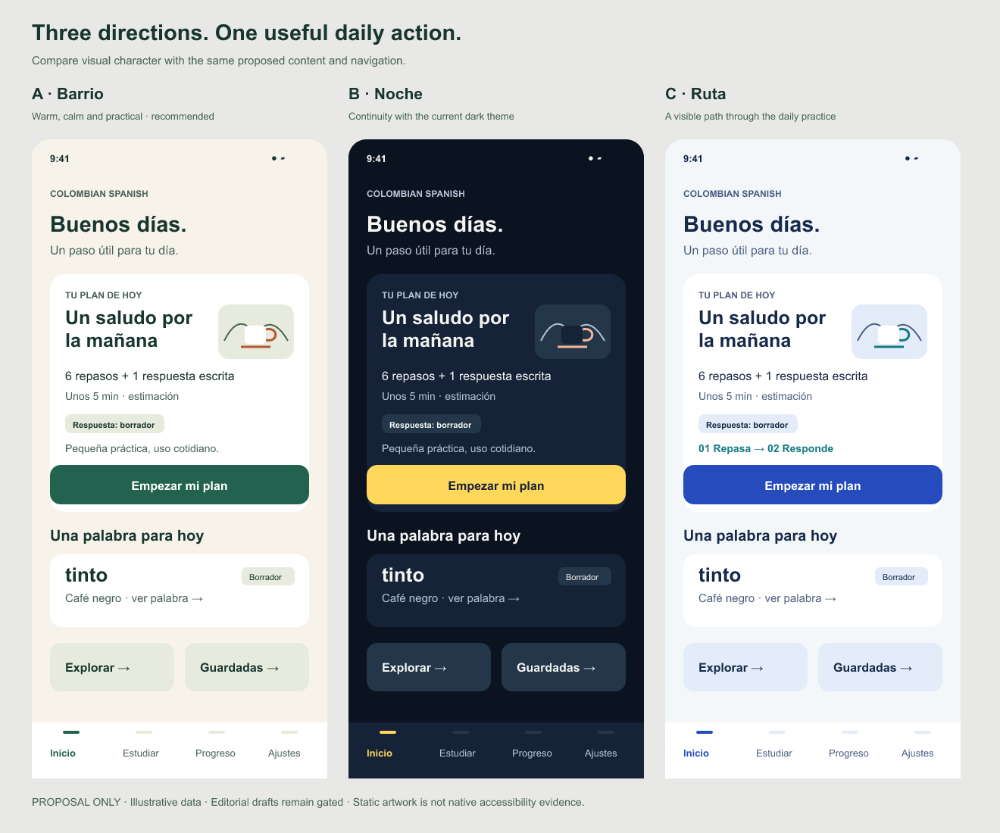
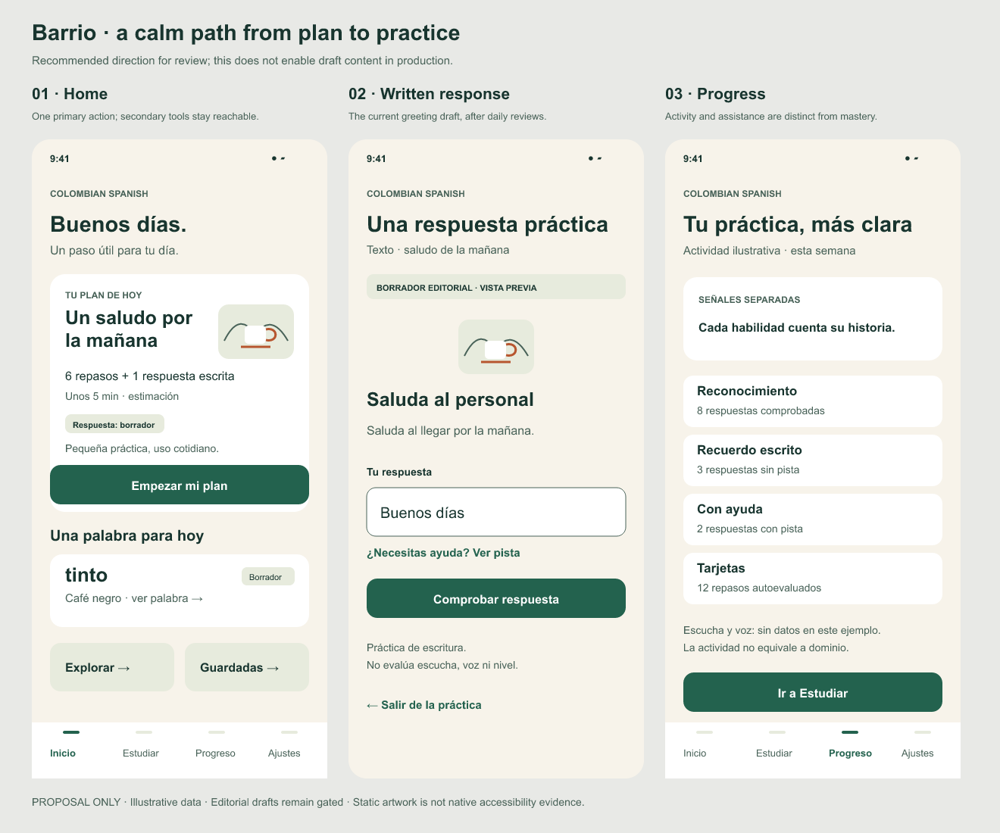

# Visual direction proposals — B08.1-A1

This is a reviewable design package, not a shipped theme or navigation change. All screen figures and counts are illustrative. The greeting and word remain editorial drafts; production gates are unchanged.

## Recommendation and tradeoffs

| Direction                | What it contributes                                                                                                                                               | Tradeoff / decision                                                                                                                                                                                                         |
| ------------------------ | ----------------------------------------------------------------------------------------------------------------------------------------------------------------- | --------------------------------------------------------------------------------------------------------------------------------------------------------------------------------------------------------------------------- |
| A · Barrio — recommended | Warm paper, deep green and original café line art create a calm daily ritual. One prominent plan action and quieter discovery controls reduce visual competition. | New light appearance needs a complete dark companion, semantic state tokens and real device review before implementation. The name and imagined café are creative proposals, not evidence of Colombian cultural acceptance. |
| B · Noche                | Refines the current dark presentation, retaining a yellow primary action and familiar contrast. Lowest visual migration cost.                                     | Less distinct from the existing app; dark-only delivery would leave light-mode work open.                                                                                                                                   |
| C · Ruta                 | A two-step review→response motif makes the daily sequence visible without fictional rewards.                                                                      | Can become cluttered when plans have different phases; route graphics must derive from the actual plan, never imply an invented curriculum or proficiency level.                                                            |

The owner selected A — Barrio in this chat on 2026-10-18 as the direction guiding the next UI design; retain B as a continuity reference. These are hypotheses about clarity and engagement, not measured effectiveness results. No market research or competitor claims are added in this package.

## Grounding and boundaries

- Home is based on `src/screens/HomeScreen.tsx`: real daily plan start/resume, due review, daily estimate and word of the day. Example counts and time do not come from a learner record.
- The written response uses the exact greeting prompt and draft answer from `src/missions/firstMorning.ts`, as selected by `src/missions/dailyResponse.ts`. The applied daily response is one greeting, **not the full coffee-order mission**. A review-only production plan must omit the written-response phase while its content gate is closed.
- The mock shows an unsubmitted input. It does not claim the answer was accepted, scheduled or graded. Assistance and completion must use the existing evaluator and persistence contract.
- Progress proposes a clearer presentation of existing kinds of evidence. Any displayed count needs an explicit selector with defined time range, deduplication and source evidence; the example is not an assertion that today's runtime already has these exact aggregates.
- The empty status bar, line-art café/hills, layout and SVG assets are original code-native artwork in this package. They depict no identifiable person, business or real location. No external image, font file, model likeness, recording, paid service or cloud account was used. Arial is referenced as a local system font, not redistributed. Human cultural/brand review and any future commissioned-media releases remain open.

## Preserve capabilities and routes

| Proposed entry      | Existing destination / constraint                                                                                                                                                           |
| ------------------- | ------------------------------------------------------------------------------------------------------------------------------------------------------------------------------------------- |
| Plan primary action | Current daily-plan state machine: start, exact resume, recoverable failure, completed follow-up; never build a replacement queue from decorative UI.                                        |
| Estudiar tab        | Existing Study and deck browsing; preserve add/manage and exact review queue behavior.                                                                                                      |
| Explorar card       | Existing Explore stack route. Proposed route access only; retain Phrasebook, Phrases, Quiz, AddCard and ManageDecks through explicit discoverable entries.                                  |
| Guardadas card      | Existing DifficultWords / flagged cards. “Guardadas” is proposed copy, not a new storage collection; reconcile naming bilingually before implementation.                                    |
| Word card           | Existing word detail/audio access, source and deck attribution; keep unavailable/disabled audio honest. No new licensed audio implied.                                                      |
| Progreso tab        | Existing Progress and daily-goal access. Separate recognition, unaided recall, assistance and self-rating; no fluency/CEFR badge from activity.                                             |
| Ajustes tab         | Existing profile/preferences, interface language, audio settings, reminders, backup/restore and deck management access. Keep development-only previews gated.                               |
| Mission exit / back | Preserve pending-save guards, durable draft, exact resumable attempt and Back behavior. Hints, correction, retry, error and completion require states beyond the single static input shown. |

## Bundle after direction approval

1. **Semantic theme foundation (B08.2):** light and dark tokens for surface/text/action/border/focus/error/success/disabled/pressed; shared button, panel, disclosure and input states. Keep existing navigation, persistence and audio contracts. Verify text contrast programmatically and visually in both appearances before delivery. This package does not claim a contrast audit.
2. **Home and discovery (B08.3):** use actual plan phases and one current primary action; preserve exact resume, cap, empty/completed/loading/error states. Add reachable Explore and flagged-card entry points with approved bilingual copy; preserve every route above. Test selectors and persistence only where behavior changes.
3. **Mission and progress presentation (B08.4):** reuse the gated player/evaluator; specify hint, assisted/correct/incorrect/retry/completed states and progress evidence selectors. Do not unlock drafts or invent mastery. Human language acceptance and effectiveness pilot remain separate.
4. **Native acceptance (B08.5 / B12.4):** narrow phone and tablet, both languages/appearances, default and maximum live text, keyboard open/closed, touch-only scrolling, focus/VoiceOver, reduced motion and cold resume. Add Android only after owner resolves its license prerequisite. Physical-device and assistive-user acceptance cannot be closed by static boards or simulator screenshots.

For all bundles: targets at least 48 points; accessible labels and expanded/disabled states; no color-only meaning; logical reading/focus order; no fixed-height text containers in runtime. Decorative art collapses at large text, while primary actions remain reachable. Motion is optional and respects reduced motion. The current SVGs are fixed-size review artifacts, not reusable accessible runtime components.

## Validation and decision

Both 1320×1100 PNGs were rendered and inspected: all three Home variants and the three-screen candidate flow fit, titles/actions are readable, no text overlaps were observed. Native simulator reruns are unnecessary for an artifact-only change and would not validate this proposed UI. Prior runtime batch `bc51829` passed CI run 39096612278; no app code or dependencies change here.

Editable sources: `home-directions.svg`, `barrio-flow.svg`; source generator `render.cjs` (verified with Node v24.5.0 and `@resvg/resvg-js` 2.6.2). Render with Node plus `@resvg/resvg-js` available outside the app tree, for example `node render.cjs /absolute/path/to/@resvg/resvg-js`. No renderer dependency is added to the app. Run project Prettier on the generator after editing. Same-machine regeneration was checked byte-for-byte. The rendered files are review artifacts; renderer/font differences can alter rasterization across machines.

**Direction selected:** A — Barrio, owner reply in this chat on 2026-10-18. Use the bundles above to develop the semantic foundation and concrete screens. This selection resolves the direction question; exact bilingual route labels, cultural/brand character, focused implementation designs and release acceptance remain separate. B08.1-A1 preparation and B08.1-A2 direction choice are complete; B08.1 and all implementation/native acceptance parents remain open.
